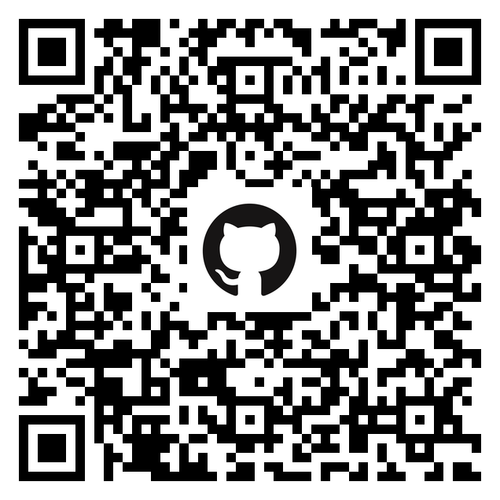

# CVAR-UPM Drone Course (ROS 2 + Aerostack2)
## Exercise 2: PID Speed Control

Solution: control/python_interface/exercise_2/exercise_2.py

The drone successfully crossed all gates in the simulator.

Demonstration video: [Watch the flight](https://www.youtube.com/watch?v=Lrwakl3W0r8)

## Share This Repository

Use this QR code to quickly share the repository:

## Control

The control track covers ROS 2 interfaces, position/speed control, and smooth trajectory tracking through gates.

- Track README: [control/README.md](control/README.md)
- Installation: [control/docs/INSTALLATION.md](control/docs/INSTALLATION.md)
- References: [control/docs/REFERENCES.md](control/docs/REFERENCES.md)
- Exercise 1: Drone Position Control ([control/exercises/Exercise1.md](control/exercises/Exercise1.md))
- Exercise 2: Drone Speed Control ([control/exercises/Exercise2.md](control/exercises/Exercise2.md))
- Exercise 3: Smooth Trajectory Speed Control Through Gates ([control/exercises/Exercise3.md](control/exercises/Exercise3.md))

## Vision

The vision track focuses on perception tasks for gate understanding and camera localization.

- Track README: [vision/README.md](vision/README.md)
- Exercise 1: Gate Segmentation in Image ([vision/exercises/Exercise1.md](vision/exercises/Exercise1.md))
- Exercise 2: Gate Corner Detection in Image ([vision/exercises/Exercise2.md](vision/exercises/Exercise2.md))
- Exercise 3: Camera Localization from Gate Image and Known Gate Size ([vision/exercises/Exercise3.md](vision/exercises/Exercise3.md))

