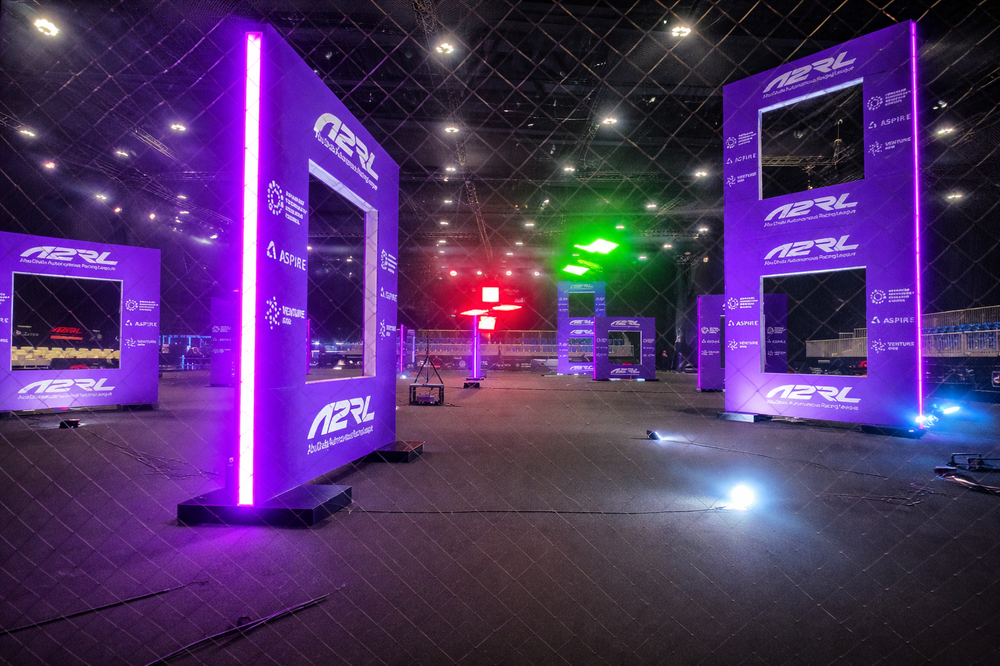

# CVAR-UPM Drone Course (ROS 2 + Aerostack2)
## Control Exercise 1: 
Solution: control/python_interface/exercise_1/exercise_2.py

The drone successfully crossed all gates in the simulator.

Demonstration video: [Watch the flight](https://youtu.be/8h_diADqOJg)

# CVAR-UPM Drone Course (ROS 2 + Aerostack2)
## Control Exercise 2: PID Speed Control

Solution: control/python_interface/exercise_2/exercise_2.py

The drone successfully crossed all gates in the simulator.

Demonstration video: [Watch the flight](https://www.youtube.com/watch?v=wpMZJnI0kgY)

